<div align="center">

# NAVER WORKS Clone · Frontend

### 메신저 · 주소록 · 게시판을 한 화면 흐름으로 잇는 협업 서비스의 화면


`Frontend` · `개인 포트폴리오` · [Backend 저장소 →](https://github.com/wjsgusdn12/naver_works_clone_api)

</div>

> 네이버웍스의 협업 경험을 참고해 직접 설계한 개인 프로젝트입니다. 실제 서비스의 코드나 디자인을 가져오지 않았습니다.
> 서버 쪽 설계는 [백엔드 README](https://github.com/wjsgusdn12/naver_works_clone_api#readme)에 있습니다.

---

## 1. 화면 지도

<!-- diagram: screen-map -->
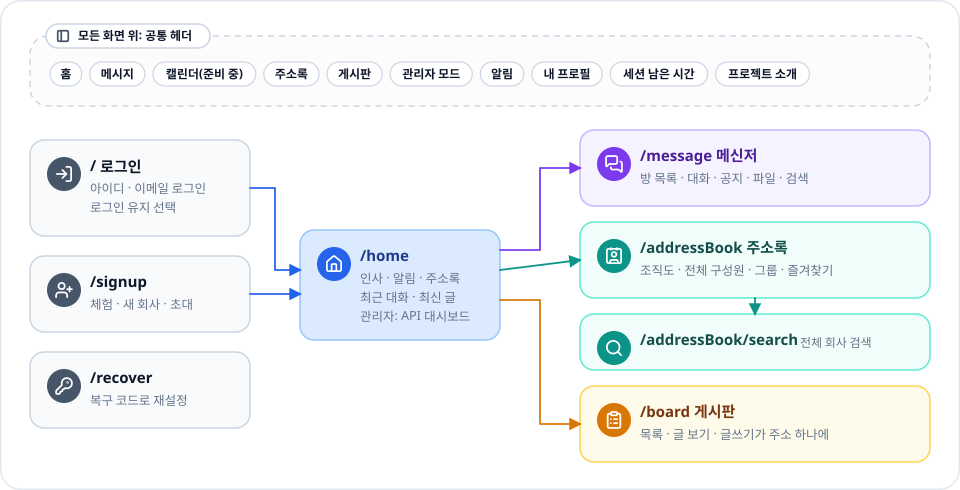

로그인하면 홈에서 메신저·주소록·게시판으로 갈라지고, 공통 헤더는 모든 화면 위에 그대로 있습니다.

---

## 2. 앱 구조

<!-- diagram: app-architecture -->
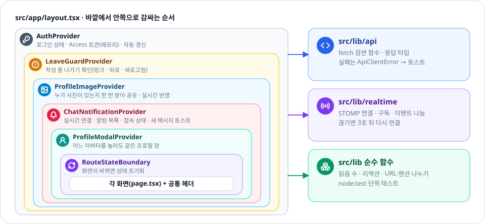

로그인·사진·실시간 연결처럼 여러 화면이 같이 쓰는 것은 바깥 층에서 한 번만 만들어 나눠 씁니다.

---

## 3. 로그인 유지

<!-- diagram: auth-ux -->
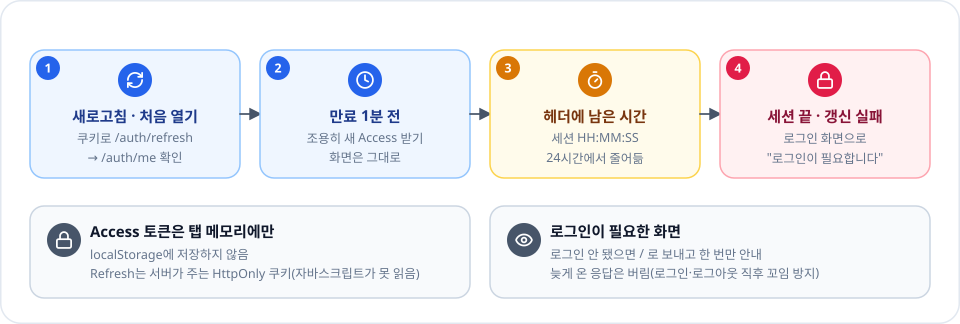

토큰은 탭 메모리에만 두고 만료 1분 전에 조용히 갱신하며, 24시간이 지나면 로그인 화면으로 보냅니다.

---

## 4. 실시간 연결

<!-- diagram: realtime -->
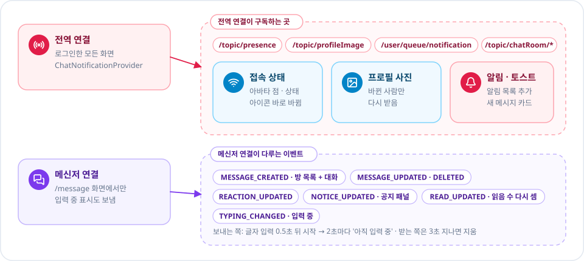

어느 화면에 있든 전역 연결이 알림·접속 상태·사진 변경을 받고, 메신저 화면은 대화용 연결을 하나 더 씁니다.

---

## 5. 메신저 화면

<!-- diagram: messenger-screen -->
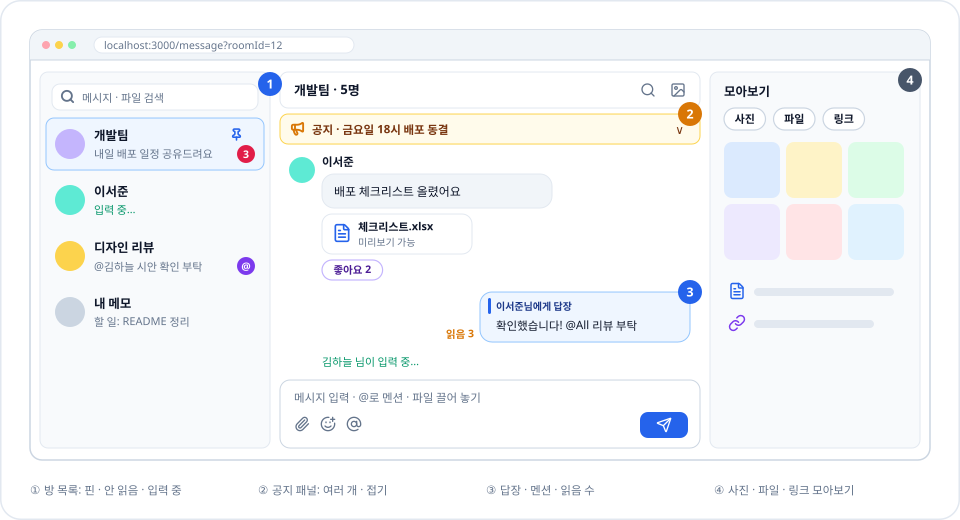

방 목록 · 대화 · 모아보기 세 칸이며, 새 메시지·입력 중·읽음 수가 새로고침 없이 바뀝니다.

---

## 6. 말풍선에서 할 수 있는 것

<!-- diagram: message-actions -->
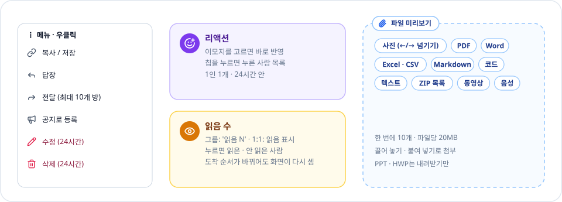

수정·삭제·리액션은 24시간 안에만 열리고, 첨부 파일은 내려받지 않고 바로 열어 봅니다.

---

## 7. 주소록 화면

<!-- diagram: address-book -->
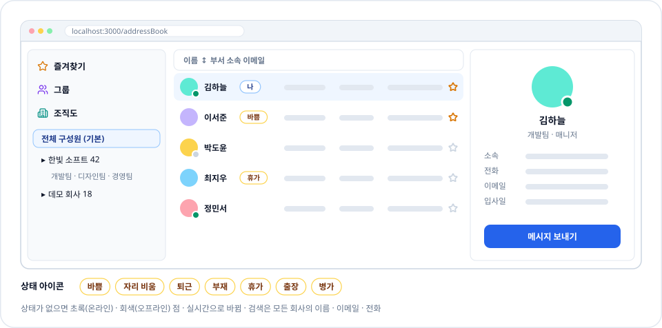

기본은 모든 회사의 전체 구성원이고, 상태 아이콘과 온라인 점이 실시간으로 바뀝니다.

---

## 8. 게시판 화면

<!-- diagram: board-screen -->
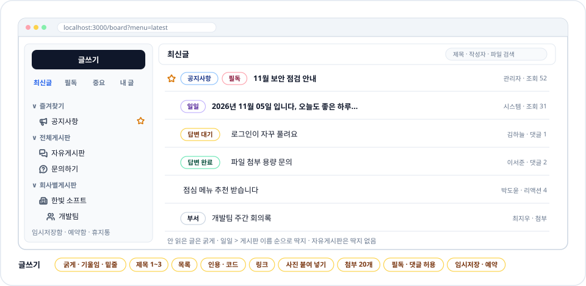

제목 왼쪽 딱지로 글 종류와 답변 여부를 한눈에 보고, 글은 서식 편집기로 씁니다.

---

## 9. 홈 · 관리자 대시보드

<!-- diagram: home -->
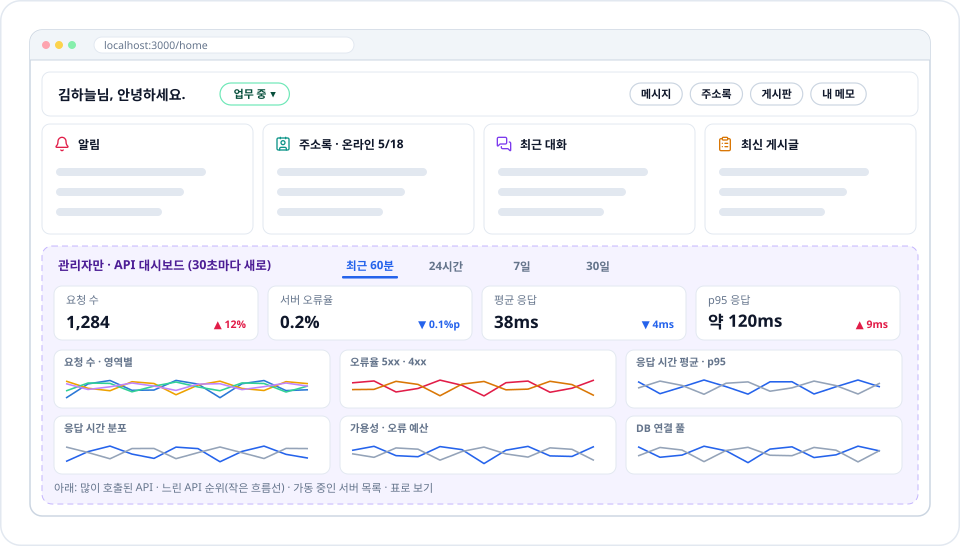

누구나 보는 카드 네 개 아래에, 관리자에게만 API 상태 대시보드가 붙습니다.

---

## 10. 공통 UI

<!-- diagram: ui-system -->
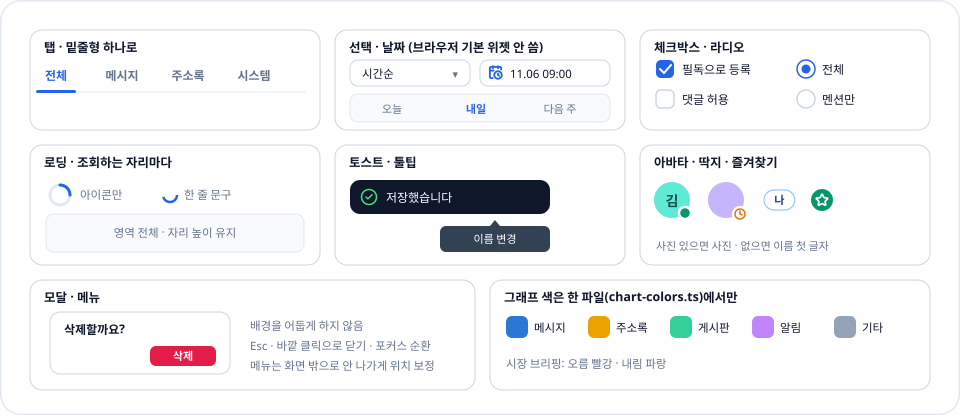

같은 모양은 한 번만 만들어 모든 화면이 같이 쓰고, 브라우저 기본 위젯은 쓰지 않습니다.

---

## 11. 다음 계획

<!-- diagram: roadmap -->
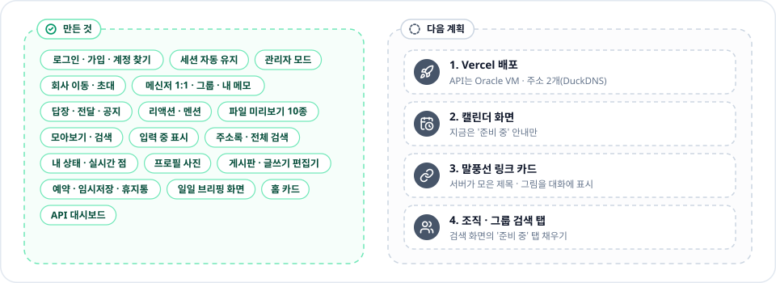

왼쪽은 지금 동작하는 화면, 오른쪽은 아직 만들지 않은 계획입니다.

---

## 기술 스택

| 분류 | 사용 |
| --- | --- |
| 프레임워크 | Next.js 16 (App Router) · React 19 · TypeScript 5 |
| 스타일 | Tailwind CSS 4 · lucide-react 아이콘 |
| 실시간 | @stomp/stompjs |
| 편집 · 미리보기 | Tiptap · docx-preview · exceljs · highlight.js · react-markdown |
| 그래프 | 라이브러리 없이 직접 그린 SVG |
| 검사 | eslint · tsc · node:test |

## 로컬 실행

```powershell
npm install
# .env.local 에 NEXT_PUBLIC_API_BASE_URL=http://localhost:9090
npm run dev                         # http://localhost:3000

npm run lint
npx tsc --noEmit
node --test "tests/**/*.test.mjs"
```

## 그림 다시 만들기

```powershell
node scripts/build-readme-art.mjs     # docs/diagrams/*.svg + docs/guide.json
```

그림 모양은 `scripts/readme-art/diagrams.mjs`, 제목과 한 줄 설명은 이 README가 원본입니다. 앱 헤더의 "프로젝트 소개" 창이 두 저장소의 같은 파일을 보여 줍니다.
